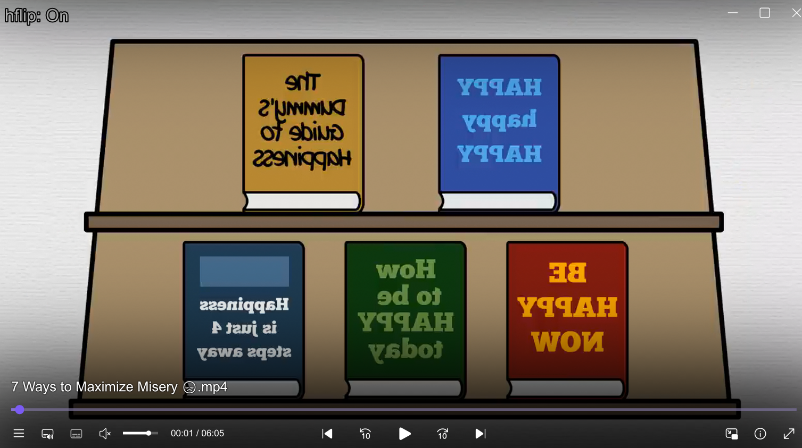

# mpv-toolkit

A collection of small Lua scripts and GLSL shaders for the [mpv](https://mpv.io/) media player.

Each tool is independent: copy only the ones you want.

## Contents

| Tool | Files | What it does |
| --- | --- | --- |
| [Horizontal flip](#horizontal-flip) | `scripts/hflip.lua`, `shaders/hflip.glsl` | Mirror the video with one key |
| [ICC profile cycler](#icc-profile-cycler) | `scripts/icc_cycle.lua` | Switch between the ICC profiles in your `colors` folder |
| [OLED vibrance](#oled-vibrance) | `shaders/Vibrance-OLED.glsl` | Vibrance with skin tone protection and deeper OLED blacks |

## Installation

Copy the files you want into your mpv config folder, keeping the folder layout:

| OS | mpv config folder |
| --- | --- |
| Windows | `%APPDATA%\mpv\` (or `portable_config\` next to `mpv.exe`) |
| Linux / macOS | `~/.config/mpv/` |

```
mpv/
├── input.conf
├── scripts/
└── shaders/
```

If you already have an `input.conf`, append the lines you need instead of replacing it.

## Horizontal flip

A tiny GLSL shader plus a toggle script that mirrors the video on the GPU, so it costs nothing in performance.



- `shaders/hflip.glsl` samples the video with a mirrored X coordinate
- `scripts/hflip.lua` adds or removes the shader and shows `hflip: On` / `hflip: Off`
- `input.conf` binds it to <kbd>Ctrl</kbd>+<kbd>H</kbd>:

  ```
  Ctrl+h      script-message hflip_toggle
  ```

## ICC profile cycler

Cycles through the `.icm` color profiles in `~~/colors` (the `colors` folder of your mpv config) and shows the active profile's name on screen. Useful to compare calibrations or switch between displays.

| Key | Action |
| --- | --- |
| <kbd>Ctrl</kbd>+<kbd>I</kbd> | Next profile |
| <kbd>Ctrl</kbd>+<kbd>J</kbd> | Previous profile |

Profiles are sorted by name. Put your `.icm` files in `colors/` and restart mpv.

## OLED vibrance

`shaders/Vibrance-OLED.glsl` boosts muted colors while leaving skin tones, midtones and highlights natural, then deepens shadows the way an OLED panel would, with a gentle cinematic contrast curve on top.

Load it from `mpv.conf`:

```
glsl-shaders-append="~~/shaders/Vibrance-OLED.glsl"
```

Every effect is a parameter you can tune with `glsl-shader-opts` (needs `vo=gpu-next`):

| Parameter | Default | Range | Effect |
| --- | --- | --- | --- |
| `vibrance_strength` | `0.3` | 0–1 | Overall vibrance boost |
| `skin_strength` | `0.5` | 0–1 | How much skin tones are protected |
| `midtone_strength` | `0.6` | 0–1 | Extra boost for midtones |
| `luma_strength` | `0.4` | 0–1 | Protection for very dark and very bright areas |
| `oled_strength` | `0.15` | 0–0.2 | Shadow crush (deeper blacks) |
| `cinema_strength` | `0.04` | 0–0.1 | Global S-curve contrast |

```
glsl-shader-opts=vibrance_strength=0.4,oled_strength=0.1
```

## Author

**Sifeddine Yassine** · [@SifeYassine](https://github.com/SifeYassine)
