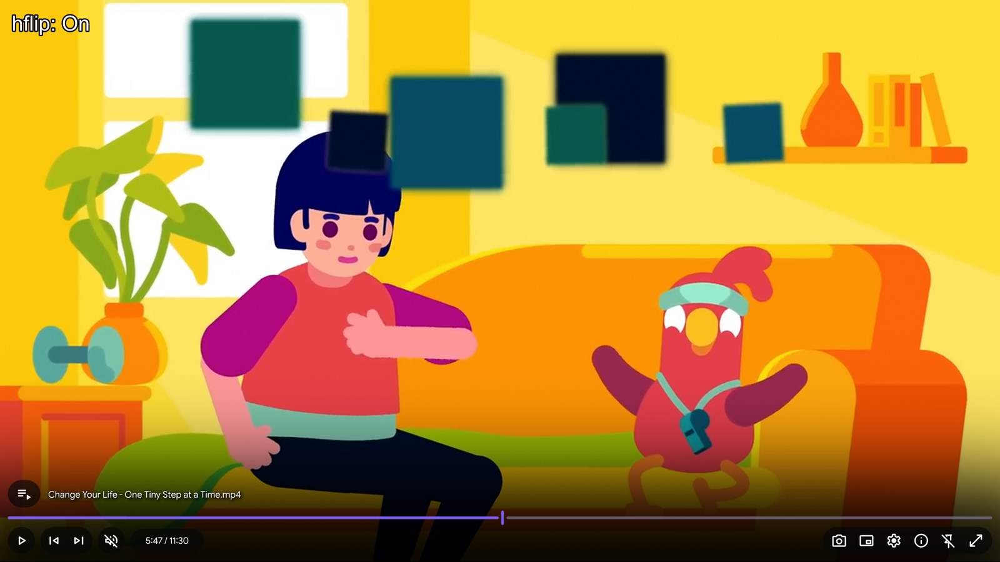
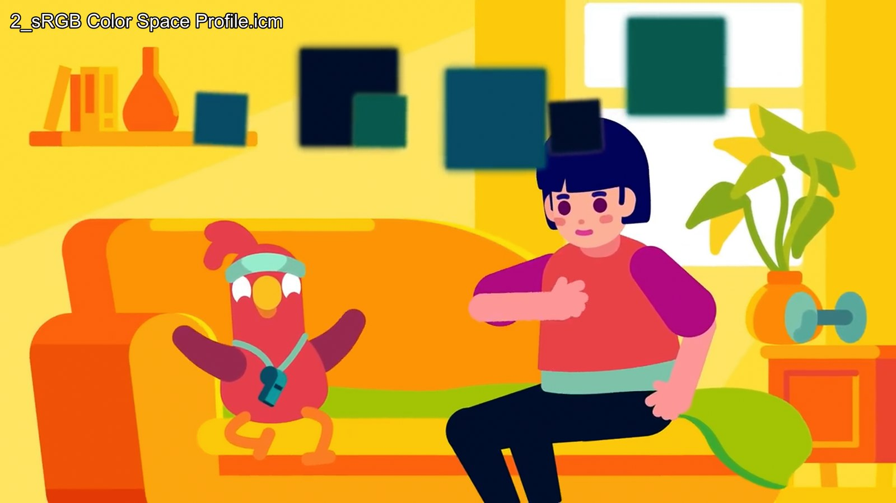
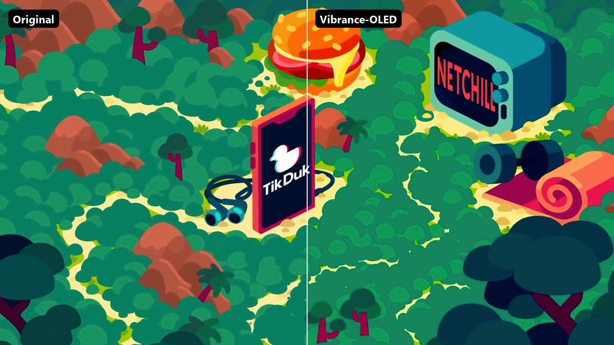
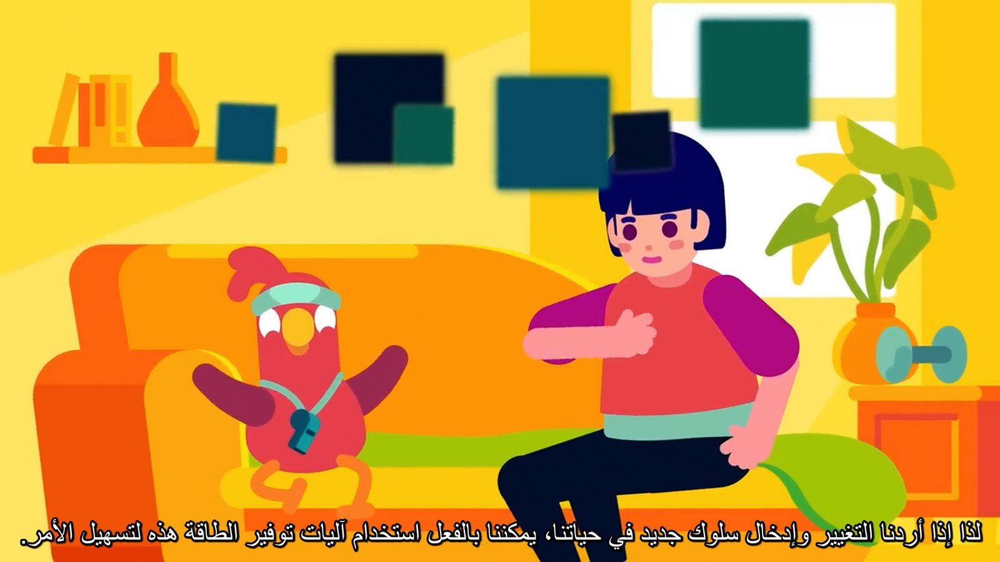
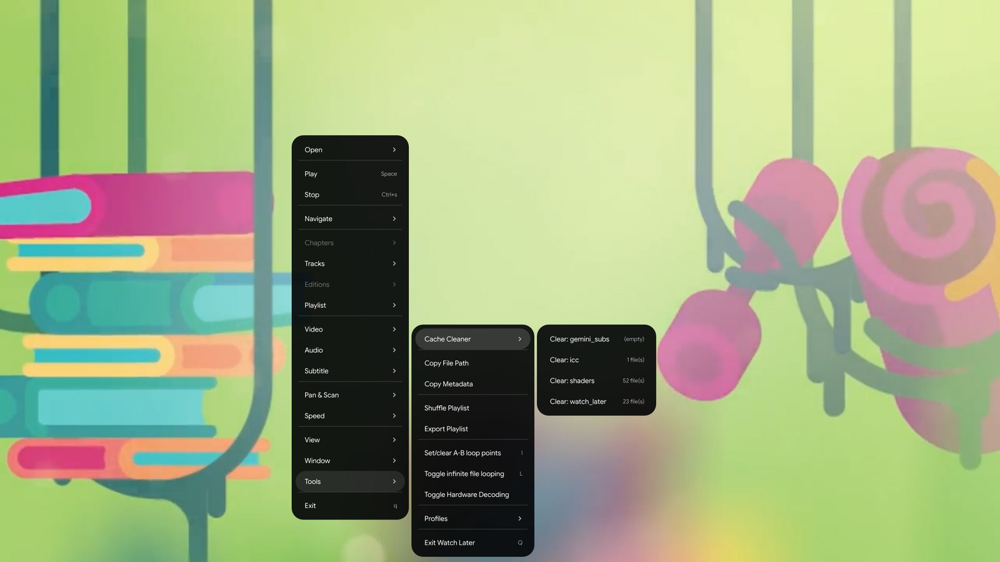

# mpv-toolkit

A collection of small Lua scripts and GLSL shaders for the [mpv](https://mpv.io/) media player.

Each tool is independent: copy only the ones you want.

## Contents

| Tool | Files | What it does |
| --- | --- | --- |
| [Horizontal flip](#horizontal-flip) | `scripts/hflip.lua`, `shaders/hflip.glsl` | Mirror the video with one key |
| [ICC profile cycler](#icc-profile-cycler) | `scripts/icc_cycle.lua` | Switch between the ICC profiles in your `colors` folder |
| [OLED vibrance](#oled-vibrance) | `shaders/Vibrance-OLED.glsl` | Vibrance with skin tone protection and deeper OLED blacks |
| [Gemini subtitles](#gemini-subtitles) | `scripts/gemini_subs.lua`, `script-opts/gemini_subs.conf` | Transcribe and translate any video into subtitles with Google Gemini |
| [Cache cleaner](#cache-cleaner) | `scripts/cache_cleaner.lua` | Empty mpv's cache folders from the right-click menu |
| [Smart skip](#smart-skip) | `scripts/smart_skip.lua`, `script-opts/smart_skip.conf` | Find and skip the openings and endings of episodes by comparing them |
| [Delete file](#delete-file) | `scripts/delete_file.lua` | Permanently delete the playing file with one key |

## Installation

Copy the files you want into your mpv config folder, keeping the folder layout:

| OS | mpv config folder |
| --- | --- |
| Windows | `%APPDATA%\mpv\` (or `portable_config\` next to `mpv.exe`) |
| Linux / macOS | `~/.config/mpv/` |

```
mpv/
├── input.conf
├── scripts/
├── script-opts/
└── shaders/
```

If you already have an `input.conf`, append the lines you need instead of replacing it.

## Requirements

- mpv with the GPU renderer (`vo=gpu-next` recommended, `vo=gpu` works too) for the shaders
- Gemini subtitles additionally need `ffmpeg` and `curl`, a free Gemini API key and, for YouTube and other sites, `yt-dlp`
- Smart skip needs an mpv build with LuaJIT (the usual Windows builds have it) plus `ffmpeg` and `ffprobe`

## Horizontal flip

A tiny GLSL shader plus a toggle script that mirrors the video on the GPU, so it costs nothing in performance.



- `shaders/hflip.glsl` samples the video with a mirrored X coordinate
- `scripts/hflip.lua` adds or removes the shader and shows `hflip: On` / `hflip: Off`
- `input.conf` binds it to <kbd>Ctrl</kbd>+<kbd>H</kbd>:

  ```
  Ctrl+h      script-message hflip_toggle
  ```

## ICC profile cycler

Cycles through the `.icm` color profiles in `~~/colors` (the `colors` folder of your mpv config) and shows the active profile's name on screen. Useful to compare calibrations or switch between displays.



| Key | Action |
| --- | --- |
| <kbd>Ctrl</kbd>+<kbd>I</kbd> | Next profile |
| <kbd>Ctrl</kbd>+<kbd>J</kbd> | Previous profile |

Profiles are sorted by name. Put your `.icm` files in `colors/` and restart mpv.

## OLED vibrance

`shaders/Vibrance-OLED.glsl` boosts muted colors while leaving skin tones, midtones and highlights natural, then deepens shadows the way an OLED panel would, with a gentle cinematic contrast curve on top.



Load it from `mpv.conf`:

```
glsl-shaders-append="~~/shaders/Vibrance-OLED.glsl"
```

Every effect is a parameter you can tune with `glsl-shader-opts` (needs `vo=gpu-next`):

| Parameter | Default | Range | Effect |
| --- | --- | --- | --- |
| `vibrance_strength` | `0.3` | 0–1 | Overall vibrance boost |
| `skin_strength` | `0.5` | 0–1 | How much skin tones are protected |
| `midtone_strength` | `0.6` | 0–1 | Extra boost for midtones |
| `luma_strength` | `0.4` | 0–1 | Protection for very dark and very bright areas |
| `oled_strength` | `0.15` | 0–0.2 | Shadow crush (deeper blacks) |
| `cinema_strength` | `0.04` | 0–0.1 | Global S-curve contrast |

```
glsl-shader-opts=vibrance_strength=0.4,oled_strength=0.1
```

## Gemini subtitles

`scripts/gemini_subs.lua` generates subtitles for videos that don't have them. It cuts the audio ahead of the playback position into chunks, sends each chunk to the [Gemini API](https://ai.google.dev/) for transcription (and optional translation) and draws the result on screen while you watch.



- Works with local files, YouTube and other sites (through `yt-dlp`) and direct stream URLs
- Optional translation into any language, with the original line shown underneath if you like
- Chunks overlap slightly so sentences crossing a boundary are never cut in half
- Saves `<video>.gemini.<language>.srt` next to the video
- Remembers finished parts, so reopening a video never sends them again
- Retries on rate limits and falls back to other models when a model's daily free quota is used up

| Key | Action |
| --- | --- |
| <kbd>Ctrl</kbd>+<kbd>G</kbd> | Turn AI subtitles on/off |
| <kbd>Ctrl</kbd>+<kbd>L</kbd> | Switch between the original language and your translation languages |

**Setup**

1. Get a free API key at [aistudio.google.com/apikey](https://aistudio.google.com/apikey).
2. Copy `script-opts/gemini_subs.conf` and set `api_key=` (or set the `GEMINI_API_KEY` environment variable instead).
3. Set `target_lang` to the language you want, or leave it empty to only transcribe.

Main options in `gemini_subs.conf`:

| Option | Default | Description |
| --- | --- | --- |
| `model` | `gemini-2.5-flash` | Gemini model to use |
| `fallback_models` | `gemini-2.5-flash-lite` | Models tried in order when the daily quota is used up |
| `target_lang` | empty | Translate into this language; empty = original language only |
| `languages` | empty | Extra languages for <kbd>Ctrl</kbd>+<kbd>L</kbd>, comma-separated |
| `show_original` | `no` | Show the original line under the translation |
| `chunk_seconds` / `lookahead_seconds` | `30` / `90` | Chunk length and how far ahead to transcribe |
| `export_srt` | `yes` | Save an `.srt` file next to the video |
| `resume` | `yes` | Cache finished parts in `~~/cache/gemini_subs` |
| `auto_start` | `no` | Turn on automatically for every file |

The free tier allows about 10 requests per minute, which is plenty with the default `max_parallel=2`.

## Cache cleaner

`scripts/cache_cleaner.lua` adds a **Cache Cleaner** submenu to the right-click menu that lists every folder inside `~~/cache` (shader cache, watch-later positions, subtitle caches, ...) with its file count. Picking one deletes the files in that folder.



It fills the menu entry tagged `#@cache_cleaner` through the `menu-ready` / `update` script messages, so it needs a right-click menu that builds its entries from `input.conf`, such as the one in [my material-osc fork](https://github.com/SifeYassine/material-osc). Add this line to `input.conf`:

```
_   ignore   #menu: Tools > Cache Cleaner   #@cache_cleaner
```

## Smart skip

`scripts/smart_skip.lua` finds the opening and ending of episodes that have no chapters, shows them as chapters and skips them.

It fingerprints the audio at the start and end of the file and compares it with other episodes of the same show: files in the same folder, episodes you played before (their fingerprints stay cached even after the files are deleted) and a library of openings and endings it already found. Audio that two episodes share is the opening or ending.

Settings (length limits, how alike file names must be, silence detection, `ffmpeg`/`ffprobe` paths) are in `script-opts/smart_skip.conf`. Fingerprints are cached in `~~/cache/smart_skip`, which the cache cleaner can empty.

## Delete file

`scripts/delete_file.lua` permanently deletes the playing file with <kbd>Shift</kbd>+<kbd>Del</kbd>. It moves on to the next file in the playlist first, then deletes the file. Streams and URLs are ignored.

> The file is deleted for good, not moved to the Recycle Bin.

## Key bindings

| Key | Tool | Action |
| --- | --- | --- |
| <kbd>Ctrl</kbd>+<kbd>H</kbd> | Horizontal flip | Toggle the mirror |
| <kbd>Ctrl</kbd>+<kbd>I</kbd> / <kbd>Ctrl</kbd>+<kbd>J</kbd> | ICC profile cycler | Next / previous profile |
| <kbd>Ctrl</kbd>+<kbd>G</kbd> | Gemini subtitles | Toggle AI subtitles |
| <kbd>Ctrl</kbd>+<kbd>L</kbd> | Gemini subtitles | Switch subtitle language |
| <kbd>Shift</kbd>+<kbd>Del</kbd> | Delete file | Delete the playing file |

## Author

**Sifeddine Yassine** · [@SifeYassine](https://github.com/SifeYassine)
